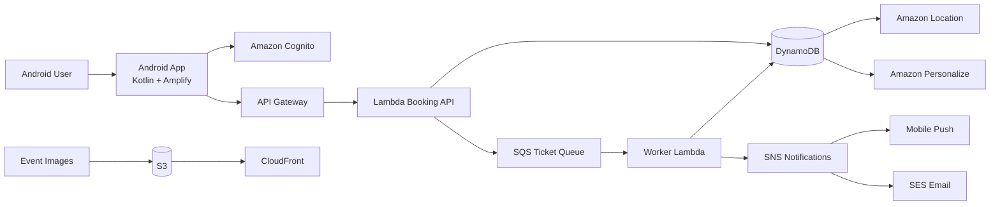

# Real-Time Event & Ticketing App

A scalable Android-first event discovery and ticketing platform built with AWS services. The product helps users discover events nearby, book tickets securely, receive confirmations instantly, and manage reminders without overbooking during high-demand periods.

---

## 1. Product Vision

The app solves a common problem in live events: users struggle to discover relevant events, and organizers face ticket overselling, delayed confirmations, and poor engagement. This platform combines:

- event discovery and recommendation
- real-time booking with queue protection
- instant notifications and receipts
- cloud-native scalability for spikes in demand

This makes it highly marketable for concerts, festivals, sports, conferences, and local community events.

---

## 2. Core Features

### User Authentication
- Sign up / sign in via email, Google, or Facebook
- Secure session management
- Role-based access for users and admins

Technology:
- Amazon Cognito
- AWS Amplify SDK for Android

### Event Discovery
- Search and filter by category, city, date, and price
- View event cards with photos and details
- Browse events on a map using location-aware discovery
- Personalized recommendations based on booking behavior

Technology:
- DynamoDB for event data
- Amazon Location Service for map-based discovery
- Amazon Personalize for event recommendations

### Ticket Booking
- View availability and pricing
- Book tickets with validation and shoulder checks
- Prevent overselling with queue logic and reservation workflows
- Generate ticket records and booking confirmations

Technology:
- API Gateway
- AWS Lambda
- SQS
- DynamoDB

### Real-Time Notifications
- Booking success confirmations
- Event reminders
- Last-minute updates and cancellations
- Push notifications and email receipts

Technology:
- Amazon SNS
- Amazon SES

### Media & Content Delivery
- Event banners and gallery images
- Fast image delivery globally
- CDN support for a smooth mobile experience

Technology:
- Amazon S3
- Amazon CloudFront

---

## 3. Recommended Architecture



---

## 4. AWS Service Breakdown

### Android App
- Native Android application using Kotlin
- AWS Amplify SDK to simplify authentication, API calls, and storage access
- UI built around event browsing, booking flow, and notification center

### Authentication Layer
Use Amazon Cognito to secure app access and support:
- email/password sign-in
- social identity providers
- MFA and password policies
- user pools for admin and customer roles

### Event Data Layer
Store event metadata in DynamoDB:
- eventId
- name
- category
- description
- startDate
- endDate
- venue
- location
- capacity
- availableSeats
- price
- imageUrl

Add secondary indexes for:
- category
- date
- city
- popularity

### Booking Queue & Overbooking Protection
Booking traffic can spike suddenly during high-demand events. The safest pattern is:

1. User requests a ticket
2. API Gateway receives the request
3. Lambda validates the purchase eligibility
4. A booking message is sent to SQS
5. Worker Lambda processes the queue in order
6. Ticket record is written only if seats remain available

This prevents race conditions and protects inventory accuracy.

### Notifications
Use SNS for push messaging and SES for transactional email:
- booking confirmation
- digital ticket mail
- reminder 24 hours before event
- check-in reminders and updates

### Media
Upload event images to S3 and serve through CloudFront so that all app users receive cached, low-latency media content.

### Location & Recommendations
- Amazon Location Service helps display venue markers and nearby events
- Amazon Personalize recommends events based on previous bookings, interactions, and category preferences

---

## 5. Example Data Model

### Event Table
```json
{
  "eventId": "evt_101",
  "name": "Sunset Live Festival",
  "category": "Music",
  "date": "2026-11-22T19:00:00Z",
  "venueName": "Harbor Arena",
  "city": "Seattle",
  "location": { "lat": 47.6062, "lon": -122.3321 },
  "capacity": 5000,
  "availableSeats": 1200,
  "price": 79.99,
  "imageUrl": "https://cdn.example.com/events/festival.jpg"
}
```

### Booking Table
```json
{
  "bookingId": "bk_9001",
  "userId": "usr_77",
  "eventId": "evt_101",
  "ticketCount": 2,
  "status": "confirmed",
  "totalAmount": 159.98,
  "createdAt": "2026-10-30T08:30:00Z"
}
```

---

## 6. Backend Flow for Ticket Booking

### Booking request flow
1. User taps “Book Tickets” in the Android app
2. App calls API Gateway with eventId and quantity
3. Lambda validates user authentication and event availability
4. Lambda places a booking message in SQS
5. Worker Lambda checks current seat inventory
6. If seats are available, it records the ticket and confirms purchase
7. SNS sends push notification and SES sends email receipt

### Important protections
- Use optimistic locking or atomic inventory updates when reducing available seats
- Keep worker processing idempotent to avoid duplicate bookings
- Persist transaction logs for auditing and support

---

## 7. Android App Implementation Plan

### Android Stack
- Kotlin
- Jetpack Compose or XML + ViewModel
- AWS Amplify SDK for authentication and API integration
- Retrofit, OkHttp, or Amplify GraphQL/API clients for backend communication
- Google Maps / Amazon Location UI for event maps

### Suggested app screens
- Splash / onboarding
- Sign-in and sign-up
- Event feed / discover screen
- Event details screen
- Booking summary page
- Payment / checkout flow
- My tickets screen
- Notifications screen
- Profile and account settings

### Privacy and security
- Never store raw payment data in the mobile app
- Use signed requests or backend payment orchestration
- Store only minimal user metadata locally
- Secure tokens via Cognito and device-safe storage

---

## 8. MVP vs. Full Product

### MVP Scope
- user sign up / login
- event catalog
- event filters and search
- basic map view
- booking flow with queue protection
- SNS push + SES email confirmations

### Full Product Scope
- personalized recommendations
- loyalty rewards
- organizer dashboard
- QR ticket check-in
- multi-location venue support
- analytics and reporting
- waitlists and resale flow

---

## 9. Deployment and Publishing Strategy

### AWS Deployment
- Frontend: AWS Amplify Hosting or a custom Android app backend API layer
- Backend: Lambda + API Gateway
- Data: DynamoDB
- Media: S3 + CloudFront
- Notifications: SNS + SES
- Monitoring: CloudWatch
- Security: IAM, Cognito, WAF protections, and secure API Gateway configuration

### Android App Store Publishing
1. Build a production-ready Android app bundle (AAB)
2. Create a Play Console listing
3. Add screenshots, icons, descriptions, and privacy policy
4. Test with internal and external tracks
5. Publish production release and monitor crash data

### Release checklist
- validate booking flows under load
- test notification delivery
- test map and location permissions
- review app privacy policy
- confirm security, error handling, and uptime monitoring

---

## 10. Suggested Development Roadmap

### Phase 1: Foundation
- set up AWS account and IAM roles
- implement Cognito auth
- launch event database schema in DynamoDB
- create sample events and upload images to S3

### Phase 2: Booking Engine
- build API Gateway + Lambda endpoints
- add SQS queue and worker processing
- validate seat reservation logic
- add SES and SNS notification integration

### Phase 3: Mobile Experience
- build Android UI and event feed
- integrate map and location features
- add booking and ticket history screens
- implement notifications and deep links

### Phase 4: Growth and Optimization
- add recommendations via Personalize
- monitor traffic in CloudWatch
- work on retention and push campaigns
- prepare for public launch and store publication

---

## 11. Monetization Ideas

- ticket platform fees per sale
- premium event access and VIP bookings
- organizer subscriptions
- sponsored event placements
- dynamic pricing for popular events
- promotional bundles and memberships

---

## 12. Why This Business Model Is Strong

This app addresses a high-frequency, high-urgency use case with strong repeat demand. The combination of discovery, booking, and real-time confirmation creates a natural funnel for the product:

- users discover events
- they book tickets quickly
- they receive reminders and updates
- they come back for future events

That repeat behavior makes it highly attractive for both business buyers and app-store growth.

---

## 13. Final Recommendation

The best MVP is a mobile-first event discovery and booking system using:

- Amazon Cognito for sign-in
- API Gateway + Lambda for booking APIs
- DynamoDB for event and ticket data
- SQS for queue-based ticket handling
- SNS + SES for notifications and receipts
- S3 + CloudFront for media delivery
- Amazon Location + Personalize for discovery and recommendations

This gives you a scalable launch-ready foundation without overbuilding early. Start with a focused MVP, validate demand with real event listings, and expand with organizer tools and recommendation features as traction grows.

---

## 14. Next Step

If you want to move from concept to execution, the next best step is to build the following in order:

1. event schema and DynamoDB tables
2. Cognito authentication
3. booking API with Lambda and SQS
4. Android app screens for browse and book
5. notifications and email integration
6. store deployment and launch preparation

This roadmap keeps the product practical, scalable, and launchable.
